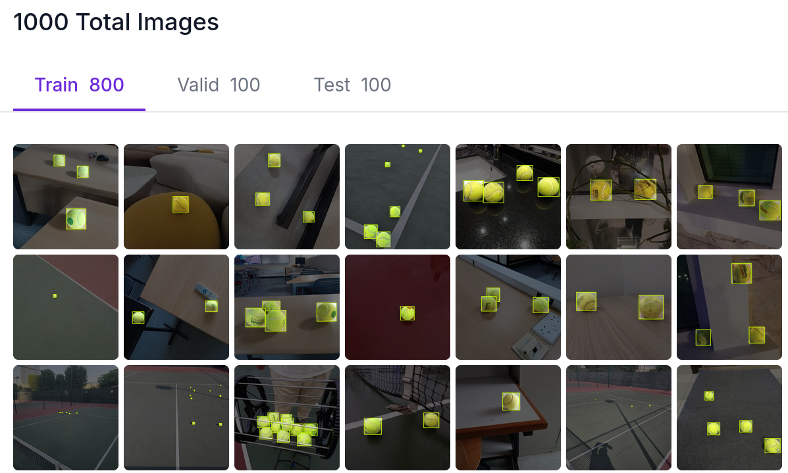
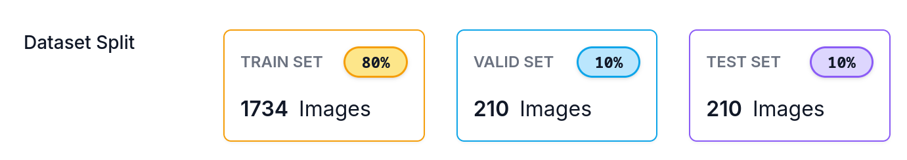
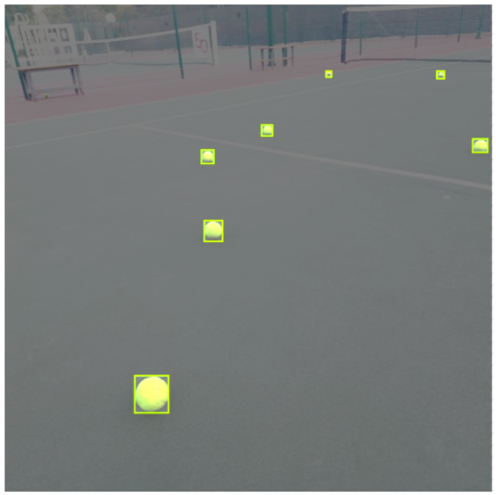
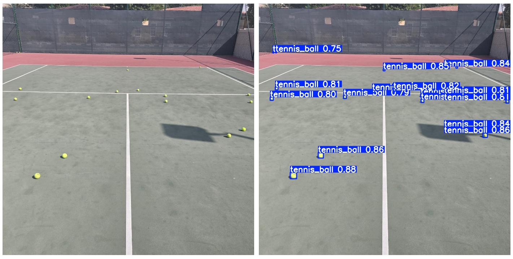
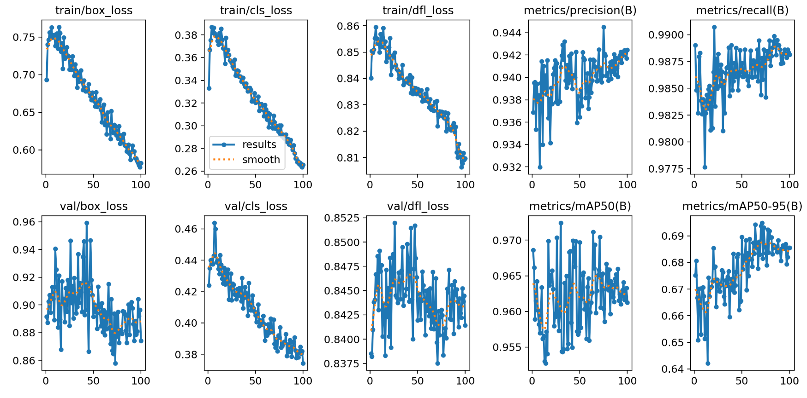

# YOLO Tennis Ball Detector

TenniRoll is a robot that walks a tennis court and gathers loose balls. The robot looks around with a phone camera, a mobile app decides where the robot should go, and the YOLO model is the part that actually finds the balls in the camera feed. This repository holds that computer vision part: the model, the data, and how I trained it.

## The model

I used the YOLO11n architecture from Ultralytics, the smallest variant in the family. It is a pretrained detection model, so it already understands general shapes and edges before it ever sees a tennis ball. Training then teaches it the specific look of a tennis ball: the yellow color, the felt texture, and the fuzzy surface. Starting from a pretrained model is what makes it possible to learn well from a few hundred real images instead of millions.

| Setting | Value |
| --- | --- |
| Architecture | YOLO11n |
| Base weights | yolo11n.pt |
| Output model | best.pt |
| Input size | 1280 x 1280 |
| Epochs | 100 |
| Classes | 1 (tennis_ball) |
| Training time | ~ 3 hours 30 minutes (Laptop RTX 4060)|

## The dataset

The dataset is a single class with one label: tennis_ball. I collected the raw images with two phones, a Samsung M53 5G and a Samsung S24 Ultra, to get the model used to more than one camera. Every shot was cropped to a 1:1 square and then resized to 1280 by 1280, because the model trains most reliably on square images of a fixed size. In total I took about 1000 real images with different court surfaces, lighting, angles, and a changing number of balls in frame.

The images were split into three groups in the usual 80/10/10 shape, which is shown in the figure below:

The validation and test sets never touch the training set, so the reported numbers are an honest estimate of how the model does on pictures it has not seen.

## Data collection and preprocessing

Before any training can happen the model must know what a tennis ball looks like from many angles and environments. The variety in the original 1000 images helps, but not enough on its own, so the dataset was grown with augmentation in Roboflow. Two operations were applied to every image:

- Brightness: two extra copies were made from each image, one 15 percent brighter and one 15 percent darker. This teaches the model to find a ball in harsh sun and in shade.
- Flip: one horizontally flipped copy was made from each image, so the model learns a ball looks the same from the left and the right.

After these steps the 1000 images became 2154, and the split above was applied to that larger set. This can be seen below

## Annotation

Annotation means drawing a box around every ball so the model has a target to learn from. Each image needs its own text file with the four coordinates of every box. I let a pretrained model draw the boxes first to save time, then went through every one by hand to fix anything that was wrong or too tight. A box that is off by a little can mislead the model, so the manual cleanup was the most important step after collecting the images. An example of annotation can be seen below:

## Training

Training runs the model over the dataset again and again, adjusting its internal settings to lower its mistakes. The script in this repo does that. It loads the pretrained YOLO11n model, points it at the dataset, and runs 100 epochs at 1280x1280. Ultralytics handles the heavy lifting, so the code itself is only a few lines. The trained weights are saved as best.pt in the runs folder and can be reused for detection without repeating the long training.

## Results

The model performed strongly on the validation set:

- Precision: about 0.945. Of every ball it flagged, roughly 94.5 percent were real balls.
- Recall: about 0.99. It caught nearly every ball that was actually in the image.
- mAP50: about 0.97. Strong detection at the standard threshold.
- mAP50-95: about 0.69. Lower because it is a much stricter test that checks detection across many box overlaps, but still a solid score.

Looking at more than one metric matters here. Precision and recall alone can both look high while the stricter mAP50-95 tells the fuller story, so all of them are reported together.

The image above on the left is the raw camera shot of the half court, and the one on the right is what the trained model predicts. The lowest confidence score among the detections is 0.75, and it still picks up the two balls far behind the net that are barely visible. All the balls in the frame are detected, which comes from the higher 1280x1280 resolution and the tuning of the model.

The charts track the four metrics across the 100 epochs, and the picture matches the numbers: precision and recall stay high and climb slowly, while the stricter mAP50-95 builds up more gradually.

## Project structure

The folders mirror how the data is organized for training. The dataset folder already exists on the machine that trained the model; you copy your own images and labels into those same spots.

